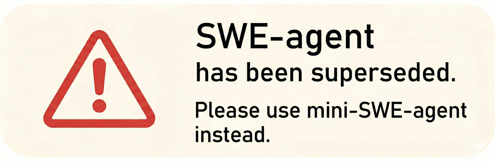
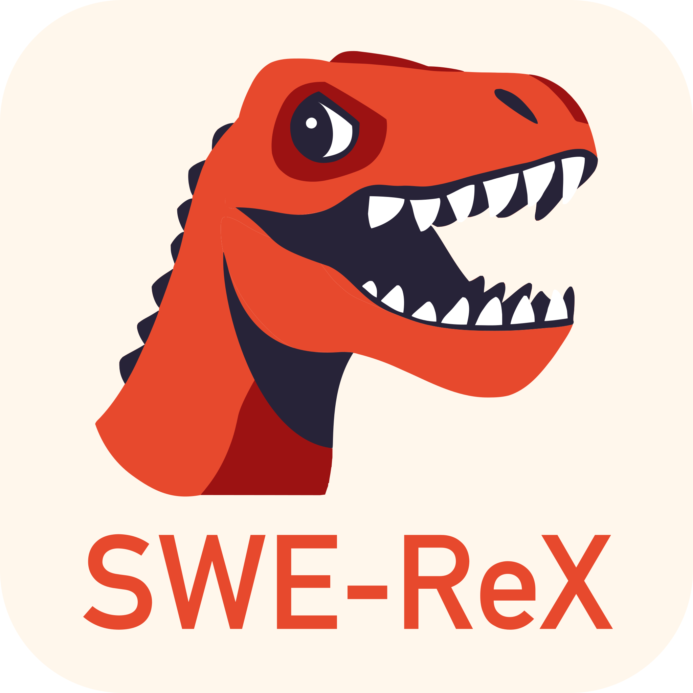
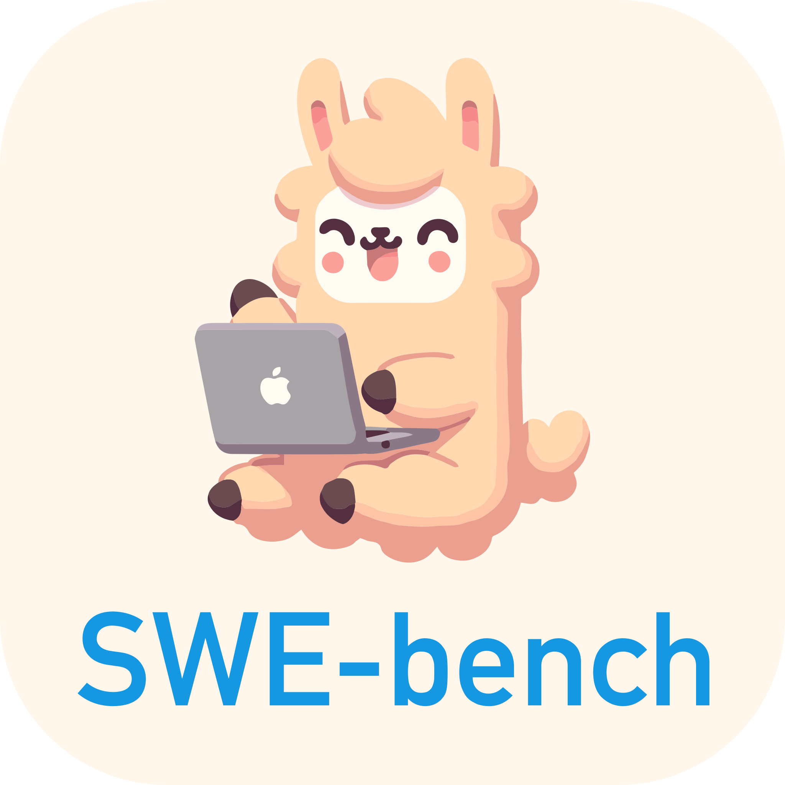
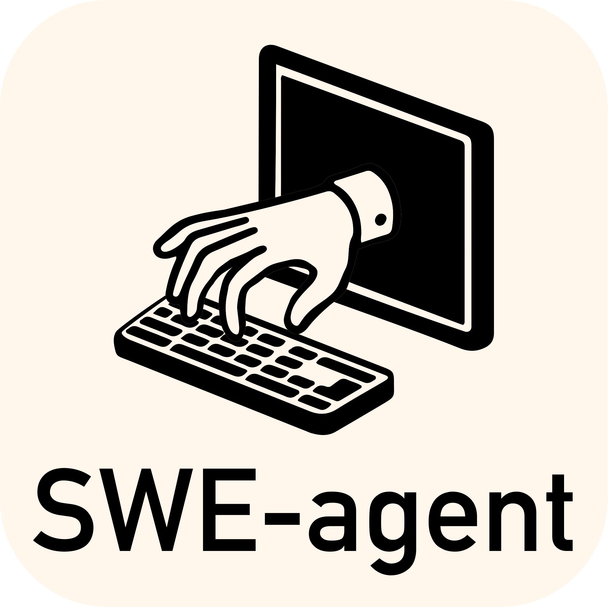
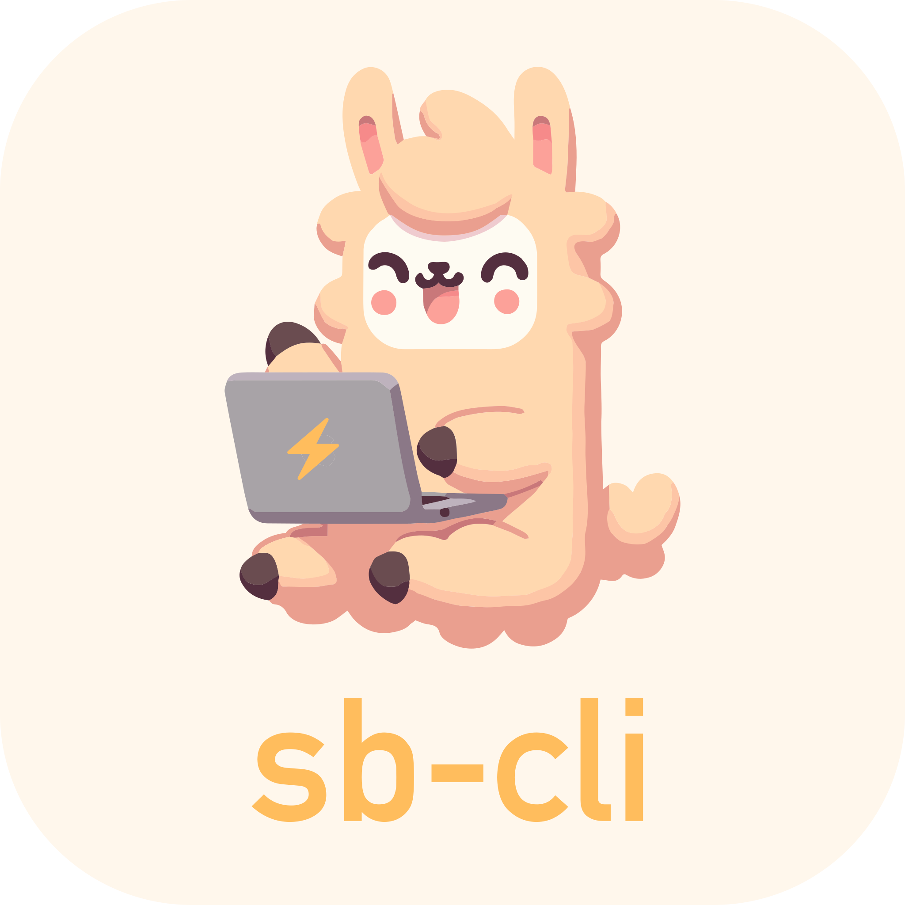

<p align="center">
  <a href="https://swe-agent.com/latest/">
    
  </a>
</p>

<p align="center">
<a href="https://swe-agent.com/latest/"></a>
<a href="https://swe-bench.slack.com"></a>
<a href="https://arxiv.org/abs/2405.15793"></a>
</p>

<p align="center">
  <a href="https://github.com/SWE-agent/mini-swe-agent/">
    
  </a>
</p>

> [!warning]
> Most of our current development effort is on [mini-swe-agent](https://github.com/SWE-agent/mini-swe-agent/),
> which has superseded SWE-agent. It matches the performance performance of SWE-agent, while being
> much simpler.
> See the [FAQ](https://mini-swe-agent.com/latest/faq/) for more details about the differences.
> Our general recommendation is to use mini-SWE-agent instead of SWE-agent going forward.


SWE-agent enables your language model of choice (e.g. GPT-4o or Claude Sonnet 4) to autonomously use tools to
[fix issues in real GitHub repositories](https://swe-agent.com/latest/usage/hello_world),
[find cybersecurity vulnerabilities](https://enigma-agent.com/), or
[perform any custom task](https://swe-agent.com/latest/usage/coding_challenges).

* ✅ **State of the art** on SWE-bench among open-source projects
* ✅ **Free-flowing & generalizable**: Leaves maximal agency to the LM
* ✅ **Configurable & fully documented**: Governed by a single `yaml` file
* ✅ **Made for research**: Simple & hackable by design

SWE-agent is built and maintained by researchers from Princeton University and Stanford University.

## 📣 News

* July 24: [Mini-SWE-Agent](https://github.com/SWE-agent/mini-SWE-agent) achieves 65% on SWE-bench verified in 100 lines of python!
* May 2: [SWE-agent-LM-32b](https://github.com/SWE-bench/SWE-smith) achieves open-weights SOTA on SWE-bench
* Feb 28: [SWE-agent 1.0 + Claude 3.7 is SoTA on SWE-Bench full](https://x.com/KLieret/status/1895487966409298067)
* Feb 25: [SWE-agent 1.0 + Claude 3.7 is SoTA on SWE-bench verified](https://x.com/KLieret/status/1894408819670733158)
* Feb 13: [Releasing SWE-agent 1.0: SoTA on SWE-bench light & tons of new features](https://x.com/KLieret/status/1890048205448220849)
* Dec 7: [An interview with the SWE-agent & SWE-bench team](https://www.youtube.com/watch?v=fcr8WzeEXyk)

## 🚀 Get started!

👉 Try SWE-agent in your browser: [](https://codespaces.new/SWE-agent/SWE-agent) ([more information](https://swe-agent.com/latest/installation/codespaces/))

Read our [documentation][docs] to learn more:

* [Installation](https://swe-agent.com/latest/installation/source/)
* [Hello world from the command line](https://swe-agent.com/latest/usage/hello_world/)
* [Benchmarking on SWE-bench](https://swe-agent.com/latest/usage/batch_mode/)
* [Frequently Asked Questions](https://swe-agent.com/latest/faq/)

[docs]: https://swe-agent.com

## SWE-agent for offensive cybersecurity (EnIGMA) <a name="enigma"></a>

</img>

[SWE-agent: EnIGMA][enigma] is a mode for solving offensive cybersecurity (capture the flag) challenges.
EnIGMA achieves state-of-the-art results on multiple cybersecurity benchmarks (see [leaderboard](https://enigma-agent.com/#results)).
Please use [SWE-agent 0.7](https://github.com/SWE-agent/SWE-agent/tree/v0.7) while we update EnIGMA for 1.0.

[enigma]: https://enigma-agent.com
[SWE-bench]: https://github.com/SWE-bench/SWE-bench
[nyu-ctf]: https://arxiv.org/abs/2406.05590

In addition, you might be interested in our other projects:


<div align="center">
  <a href="https://github.com/SWE-agent/mini-SWE-agent"></a>
   &nbsp;&nbsp;
  <a href="https://github.com/SWE-agent/SWE-ReX"></a>
   &nbsp;&nbsp;
  <a href="https://github.com/SWE-bench/SWE-bench"></a>
  &nbsp;&nbsp;
  <!-- <a href="https://github.com/SWE-agent/SWE-agent"></a> -->
  <a href="https://github.com/SWE-bench/SWE-smith"></a>
  &nbsp;&nbsp;
  <a href="https://github.com/SWE-bench/sb-cli"></a>
</div>

## Contributions <a name="contributions"></a>

If you'd like to contribute to the codebase, we welcome [issues](https://github.com/SWE-agent/SWE-agent/issues) and [pull requests](https://github.com/SWE-agent/SWE-agent/pulls)! For larger code changes, we always encourage discussion in issues first.

## Citation & contact <a name="citation"></a>

SWE-agent is an academic project started at Princeton University by John Yang*, Carlos E. Jimenez*, Alexander Wettig, Kilian Lieret, Shunyu Yao, Karthik Narasimhan, and Ofir Press.
Contact person: [John Yang](https://john-b-yang.github.io/), [Carlos E. Jimenez](http://www.carlosejimenez.com/), and [Kilian Lieret](https://www.lieret.net/) (Email: johnby@stanford.edu, carlosej@cs.princeton.edu, kl5675@princeton.edu).

If you found this work helpful, please consider citing it using the following:

<details>
<summary> SWE-agent citation</summary>

```bibtex
@inproceedings{yang2024sweagent,
  title={{SWE}-agent: Agent-Computer Interfaces Enable Automated Software Engineering},
  author={John Yang and Carlos E Jimenez and Alexander Wettig and Kilian Lieret and Shunyu Yao and Karthik R Narasimhan and Ofir Press},
  booktitle={The Thirty-eighth Annual Conference on Neural Information Processing Systems},
  year={2024},
  url={https://arxiv.org/abs/2405.15793}
}
```
</details>

If you used the summarizer, interactive commands or the offensive cybersecurity capabilities in SWE-agent, please also consider citing:

<details>
<summary>EnIGMA citation</summary>

```bibtex
@misc{abramovich2024enigmaenhancedinteractivegenerative,
      title={EnIGMA: Enhanced Interactive Generative Model Agent for CTF Challenges},
      author={Talor Abramovich and Meet Udeshi and Minghao Shao and Kilian Lieret and Haoran Xi and Kimberly Milner and Sofija Jancheska and John Yang and Carlos E. Jimenez and Farshad Khorrami and Prashanth Krishnamurthy and Brendan Dolan-Gavitt and Muhammad Shafique and Karthik Narasimhan and Ramesh Karri and Ofir Press},
      year={2024},
      eprint={2409.16165},
      archivePrefix={arXiv},
      primaryClass={cs.AI},
      url={https://arxiv.org/abs/2409.16165},
}
```
</details>


## 🪪 License <a name="license"></a>
MIT. Check `LICENSE`.


<div align="center">

[](https://github.com/SWE-agent/SWE-agent/actions/workflows/pytest.yaml)
[](https://github.com/SWE-agent/SWE-agent/actions/workflows/build-docs.yaml)
[](https://codecov.io/gh/SWE-agent/SWE-agent)
[](https://results.pre-commit.ci/latest/github/SWE-agent/SWE-agent/main)
[](https://github.com/SWE-agent/SWE-agent/actions/workflows/check-links-periodic.yaml)

</div>
# 🤖 SWE-Agent – AI-Powered Autonomous Software Engineering

<p align="center">
  
  
  
  
</p>

## 📌 Overview

SWE-Agent is an AI-powered software engineering agent designed to help automate software development tasks. It uses Large Language Models (LLMs) to understand programming problems, navigate codebases, analyze source files, and attempt to resolve software issues.

The project demonstrates how AI agents can interact with development environments and use specialized tools to perform coding tasks with minimal human intervention.

SWE-Agent can be used for software debugging, automated issue resolution, code analysis, research experiments, and agent-based programming workflows.

**Repository:** [SWE-agent-main](https://github.com/Ravi506051/SWE-agent-main)

## ✨ Key Features

- 🤖 **Autonomous Coding:** Uses an AI model to attempt programming tasks.
- 🐛 **Automated Debugging:** Helps investigate errors and identify potential fixes.
- 🔍 **Codebase Exploration:** Supports navigating and examining project files.
- 🧠 **LLM Integration:** Works with supported language model configurations.
- 🛠️ **Tool-Based Interaction:** Allows an agent to use development tools to complete tasks.
- ⚙️ **Configurable Workflow:** Supports configuration-driven agent behavior.
- 🧪 **Research Friendly:** Useful for experimenting with AI agents and automated software engineering.
- 🔐 **Security Research:** Related SWE-Agent workflows can support authorized security research and CTF challenges.

## 🎯 Project Objectives

The main objectives of this project are to:

1. Explore the use of AI agents in software engineering.
2. Automate parts of the software debugging and issue-resolution process.
3. Investigate how language models interact with code and development tools.
4. Reduce repetitive manual effort in software development.
5. Understand the architecture and workflow of autonomous coding agents.

## ⚙️ How It Works

A typical SWE-Agent workflow follows these steps:

1. **Task Input:** Provide a software issue or programming task.
2. **Code Analysis:** The agent examines relevant source files and available context.
3. **Planning:** The language model determines possible actions.
4. **Tool Interaction:** The agent uses available tools to inspect or modify code.
5. **Solution Attempt:** The agent generates a potential fix.
6. **Validation:** The proposed changes can be tested and reviewed.
7. **Human Review:** A developer checks the result before accepting the changes.

> Note: The exact workflow depends on the implementation, model, configuration, and tools enabled in the repository.

## 🧰 Technology Stack

- **Programming Language:** Python
- **Artificial Intelligence:** Large Language Models (LLMs)
- **Agent Architecture:** Tool-using AI agent
- **Configuration:** YAML and environment variables, where supported
- **Development Tools:** Git and GitHub
- **Testing:** Project-supported testing and validation tools

## 📂 Project Structure

The exact structure depends on the files available in this repository.

A typical AI software engineering agent may contain:

```text
SWE-agent-main/
├── README.md
├── config/
├── docs/
├── tests/
├── tools/
├── sweagent/
├── requirements.txt
└── .env.example
```

Some directories or files may differ in this repository.

## 🚀 Getting Started

### 1. Clone the Repository

```bash
git clone https://github.com/Ravi506051/SWE-agent-main.git
cd SWE-agent-main
```

### 2. Create a Virtual Environment

```bash
python -m venv .venv
```

Activate it on Windows:

```bash
.venv\Scripts\activate
```

Activate it on Linux or macOS:

```bash
source .venv/bin/activate
```

### 3. Install Dependencies

If the repository includes a `requirements.txt` file:

```bash
pip install -r requirements.txt
```

Otherwise, follow the installation instructions provided by the project.

### 4. Configure the Language Model

Configure a supported language model and its required credentials according to the project's documentation.

If an `.env.example` file is available, use it as a reference for creating your local environment configuration.

Never commit API keys, access tokens, or other secrets to GitHub.

### 5. Run the Agent

Follow the repository's documented entry point and configuration instructions.

For the upstream SWE-Agent project, the command-line interface may support commands such as:

```bash
sweagent --help
```

Check the installed version and project documentation before running a specific task.

## 💡 Use Cases

### Software Development
Assist with programming tasks and explore potential code changes.

### Bug Investigation
Analyze errors and investigate possible causes of software defects.

### Codebase Understanding
Explore unfamiliar repositories and identify relevant source files.

### AI Research
Experiment with LLM-driven agents, tool use, and automated programming.

### Authorized Security Research
Study security-related coding challenges in controlled environments where permission has been granted.

## 🔒 Security and Best Practices

- Review AI-generated code before using it.
- Run tests before merging proposed changes.
- Use isolated environments for untrusted code.
- Keep API keys and credentials private.
- Grant only the minimum permissions necessary.
- Test changes on repositories you own or are authorized to access.

AI-generated fixes may be incomplete, incorrect, or introduce new bugs. Human review remains important.

## ⚠️ Limitations

- Performance depends on the selected language model.
- Complex tasks may require multiple attempts.
- Model API usage may incur costs.
- Incorrect configurations can prevent execution.
- Generated code requires testing and review.
- Not every issue can be solved automatically.

## 🔮 Future Improvements

Potential improvements for this project include:

- Better automated test generation.
- Improved error diagnosis and recovery.
- Integration with additional language models.
- Enhanced code-quality analysis.
- More detailed execution logs and reports.
- Human approval checkpoints for sensitive operations.
- Evaluation on software engineering benchmarks.

These are possible extensions, not claims about currently implemented features.

## 🤝 Contributing

Contributions, suggestions, and bug reports are welcome.

1. Fork the repository.
2. Create a new branch.
3. Make your changes.
4. Test your implementation.
5. Submit a pull request with a clear description.

## 📚 References

- [Your GitHub Repository](https://github.com/Ravi506051/SWE-agent-main)
- [Official SWE-Agent Project](https://github.com/SWE-agent/SWE-agent)
- [SWE-Agent Documentation](https://swe-agent.com/)
- [SWE-Agent Research Paper](https://arxiv.org/abs/2405.15793)

## 👨‍💻 Author

**Ravi Kumar Rao**

B.Tech Information Technology  
Interests: Artificial Intelligence, Machine Learning, Data Science, and AI Agents.

- GitHub: [@Ravi506051](https://github.com/Ravi506051)

## 📄 License

Refer to the repository's existing `LICENSE` file for licensing terms.

---

<p align="center">
  ⭐ If you find this project useful, consider starring the repository!
</p>

## Fork Maintenance Note

This repository is a fork/copy of the upstream SWE-agent project. For current usage instructions, release status, issue tracking, and development guidance, consult the upstream SWE-agent documentation and repository. Keep local experiments clearly separated from upstream content and preserve the original license and attribution.

## Safe Experimentation

Run coding agents in an isolated environment with narrowly scoped repository permissions. Review proposed patches before applying them, avoid exposing secrets in prompts or logs, and do not allow untrusted issue text to authorize destructive commands.

## Project Development Notes

Evaluate expression classes on diverse lighting, poses, and demographics without assuming model outputs reveal a person's true emotional state.

For reproducibility, record source versions, environment and dependency versions, configuration, and actual test outputs. Clearly label sample data and illustrative results; never commit secrets or private data.

### Technical Deep Dive

This repository includes upstream SWE-agent material. Preserve the upstream project documentation, configuration formats, license, and attribution; treat local notes as fork-specific guidance rather than claiming they describe a separate implementation. The agent workflow typically combines task context, repository inspection, model-generated tool actions, execution feedback, and a final patch or report.

Suggested engineering checks: run tasks in disposable workspaces with least-privilege access, cap tool calls and execution time, capture reproducible logs, review diffs and run tests before accepting patches, and never expose credentials to untrusted repository content.

## Personal Learning and Safe Experimentation Notes

This repository is an upstream SWE-agent project. This fork is useful for studying how an LLM-driven software engineering agent inspects repositories, chooses tools, edits code, and validates changes.

For safe experiments, use a disposable test repository or isolated environment, grant only the permissions required for the task, and review every proposed file modification and shell command. Never provide production credentials or unrestricted access to sensitive repositories. Record the issue description, agent configuration, tool trace, test results, and any human corrections so experiments are reproducible.

This supplementary note does not change the upstream project's ownership, documentation, or license.
